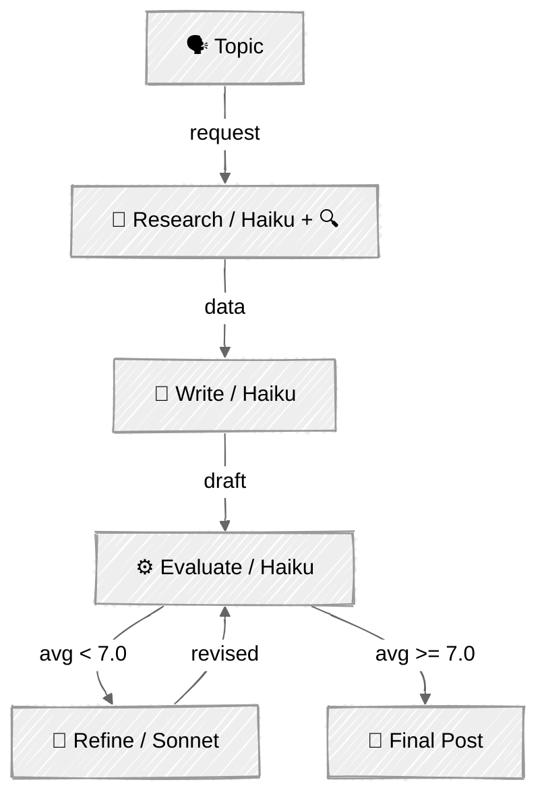

<!-- ---
title: "Evaluator-Optimizer"
description: "One LLM generates, another critiques, and the cycle repeats until quality thresholds are met"
icon: "refresh"
--- -->

# Evaluator-Optimizer — The Editor's Desk

One LLM generates a response while another evaluates it in a loop, refining until a quality threshold is met. Generator and Evaluator are different prompts with different goals.

## 🎯 What You'll Learn

- Use an LLM as a judge to score generated content on defined dimensions
- Define evaluation criteria and enforce them via structured tool output
- Build an evaluate → refine loop that converges on a quality threshold
- Separate the generator and evaluator roles to avoid conflicting incentives

## 📦 Available Examples

| Provider | File | Description |
|----------|------|-------------|
|  | [01_evaluator_optimizer.py](01_evaluator_optimizer.py) | Blog post refinement with 5-dimension evaluation loop |
| DeepSeek | [02_evaluator_optimizer_deepseek.py](02_evaluator_optimizer_deepseek.py) | Write, evaluate, and refine with DeepSeek's Responses API |

## 🚀 Quick Start

> **Prerequisites:** Python 3.11+, API keys, and uv. See [SETUP.md](../../SETUP.md) for full setup instructions.

```bash
uv run --directory 02-effective-agents/05-evaluator-optimizer python {script_name}

# Example
uv run --directory 02-effective-agents/05-evaluator-optimizer python 01_evaluator_optimizer.py

# DeepSeek (requires DEEPSEEK_API_KEY in the root .env)
uv run --directory 02-effective-agents/05-evaluator-optimizer python 02_evaluator_optimizer_deepseek.py
```

Or use the [Code Runner](https://marketplace.visualstudio.com/items?itemName=formulahendry.code-runner) VS Code extension to run the currently open script with a single click.

## 🔑 Key Concepts



### Pipeline: Research → Write → Evaluate → Refine

The pipeline separates web search from writing to control token costs:

1. **Research** — web search gathers current data (Haiku + `web_search` tool)
2. **Write** — synthesizes from research data, no tools (Haiku, text only)
3. **Evaluate** — 5-dimension scoring via structured output (Haiku, `tool_choice`)
4. **Refine** — rewrites from feedback + full draft, no tools (Sonnet)

Web search injects ~25-35k input tokens per search. By isolating it to the research phase, the write and refine steps stay lean.

The DeepSeek version uses **Write → Evaluate → Refine** because its Responses API does not provide the web search tool used by the Anthropic example. It uses `deepseek-flash` for writing and evaluation and `deepseek-v4-pro` for refinement. Set `DEEPSEEK_API_KEY` in the root `.env`; optionally override `DEEPSEEK_EVALUATOR_MODEL`, `DEEPSEEK_EVALUATOR_LIGHT_MODEL`, or `DEEPSEEK_BASE_URL`. Its evaluator checks concrete criteria for each dimension, uses anchored score bands and caps for serious accuracy problems, and returns a draft-specific reason for every score. Issues and suggestions must be paired and actionable. Technical accuracy scores cannot verify current facts without external sources. It uses a 9.5 average-score threshold and allows at most four evaluations of the initial draft and its revisions (up to three revisions). Every round's revision suggestions are written to the log.

### Separation of Concerns

The writer, evaluator, and refiner have fundamentally different goals:
- **Writer**: produce creative, engaging content from research data
- **Evaluator**: critically assess quality against objective criteria
- **Refiner**: address specific feedback while maintaining voice

Combining these into one prompt creates conflicting incentives. Separating them enables targeted improvement.

### Structured Evaluation

Scores on five dimensions (1-10):

- **Clarity** — can engineers follow without re-reading?
- **Technical Accuracy** — is info correct and current?
- **Structure** — logical flow, easy to navigate?
- **Engagement** — would engineers want to read this?
- **Human Voice** — does it sound like a real person?

Plus: specific issues and actionable suggestions — fed back to the refiner as structured feedback.

### Convergence

The loop terminates when the average score reaches its threshold or the iteration limit. The Anthropic script uses a 7.0 threshold; its `MAX_REFINEMENTS = 2` currently permits two evaluations and one revision. The DeepSeek script uses a 9.5 threshold; its `MAX_EVALUATIONS = 4` permits four evaluations and up to three revisions. Most improvement happens in the first refinement — diminishing returns are real:

```python
SCORE_THRESHOLD = 7.0
MAX_REFINEMENTS = 2
```

### Token Cost Control

Each phase uses only the context it needs — no accumulated chat history:

- **Isolate expensive tools** — web search runs once in research; all other phases are text-only
- **Right-size models** — Haiku handles research, writing, and evaluation; Sonnet is reserved for refinement where writing quality matters most
- **Cap output** — structured evaluation returns compact JSON, not prose

## ⚠️ Important Considerations

- Evaluators can be overly generous or harsh — calibrate your threshold
- The evaluator uses Haiku (fast, cheap) for scoring; the refiner uses Sonnet for higher writing quality
- Diminishing returns: most improvement happens in the first refinement

## 👉 Next Steps

- [06 - Human-in-the-Loop](../06-human-in-the-loop/) — add human checkpoints to the workflow
- Experiment: adjust `SCORE_THRESHOLD` and `MAX_REFINEMENTS` to find the quality/cost balance
- Compare output quality with and without the research phase
